<!--
  Cards are animated SVGs generated by scripts/render_cards.py from data/profile.json,
  refreshed daily by .github/workflows/cards.yml. Edit data/profile.json, not the SVGs.
-->

  

  

  
  
  

  

  

  

  
  
  

  <a href="https://www.omerchandna.com">Website</a> ·
  <a href="https://linkedin.com/in/omer-chandna">LinkedIn</a> ·
  <a href="https://www.omerchandna.com/blog">Blog</a> ·
  <a href="https://x.com/omerchandna">X</a> ·
  <a href="https://www.omerchandna.com/Omer__Resume.pdf">Resume</a> ·
  <a href="mailto:omer.chandna@torontomu.ca">Email</a>

